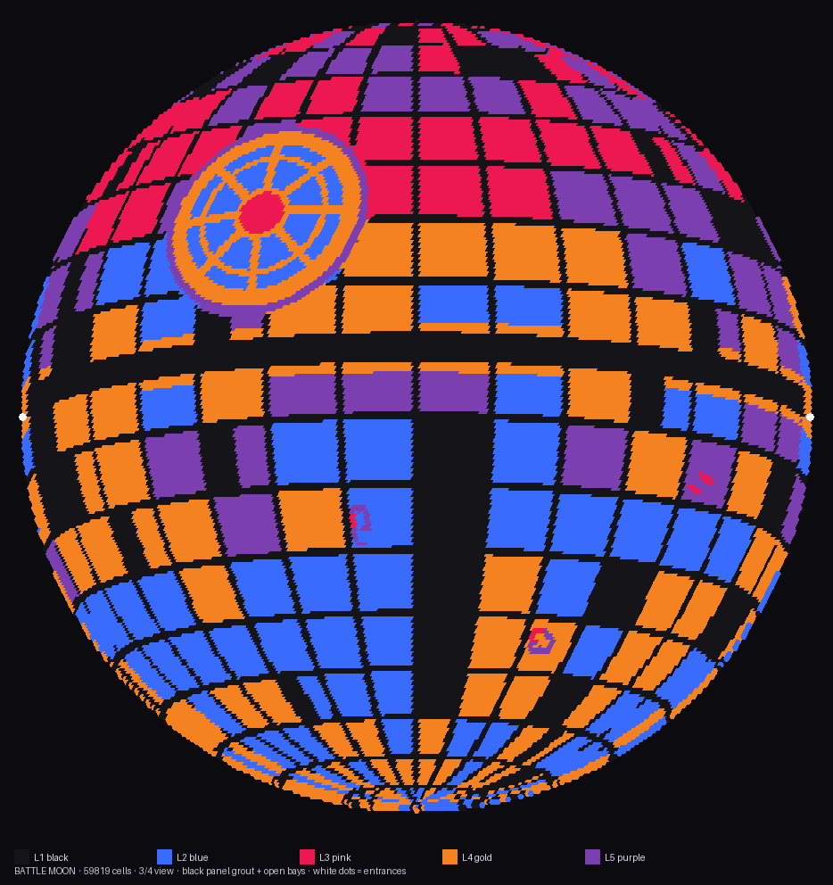
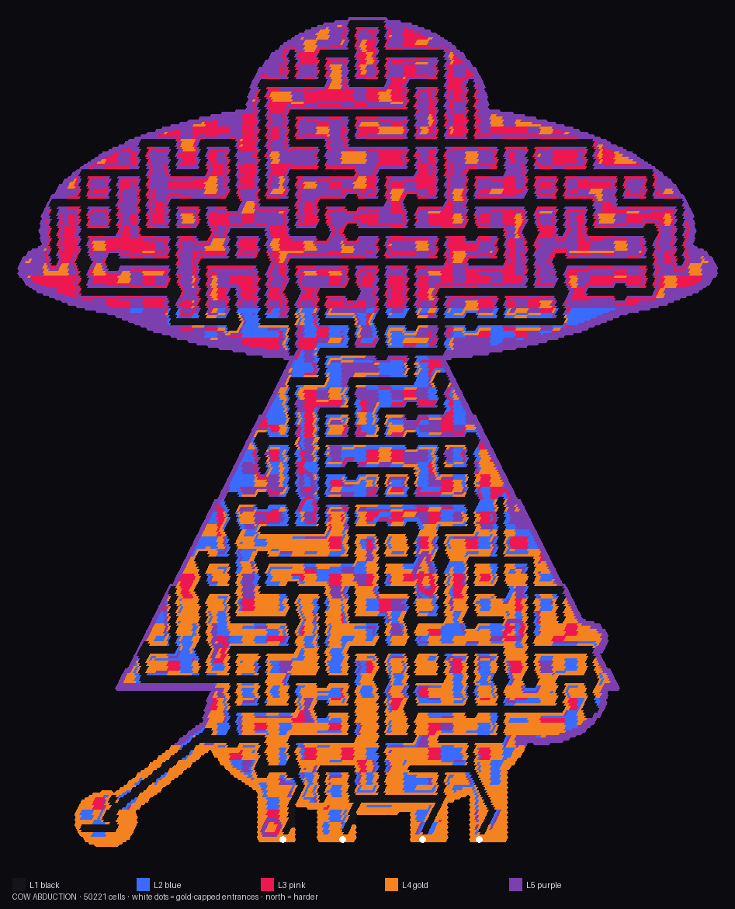

# Graveyard Orbit Maps

Two original custom contracts for **Graveyard Orbit** (Steam AppID 4654120),
generated from hex cells and injected at runtime by a small BepInEx plugin.

| Map | Cells | What it is |
|---|---:|---|
| **BATTLE MOON** | 59,819 | A planet-killer battlestation in 3/4 view, with black panel grout, open bays, a wide equatorial trench, and a superlaser dish north of the equator. |
| **COW ABDUCTION** | 50,221 | A saucer/dome UFO tractor-beaming a cow, with four gold-capped entrances and a 3-wide black maze. |

---

## BATTLE MOON



A ~60k-cell battlestation seen from **below and to the right**, so the hull
curves away toward the poles and the superlaser dish sits **north of the
equator, left of centre**.

- **31.9% black cells (19,080)** used as structure, not as a maze:
  - black **grout** between every 10° × 11.25° hull panel,
  - **open panel bays** (8% fully open, 8% half-open recesses),
  - a **wide equatorial trench**: 2,889 cells, 98.8% black, about 10 cells
    across, limb to limb.
- **Superlaser dish:** 3,051 cells. Pink emitter core, gold core ring, blue
  basin with eight gold ribs and a groove, gold rim, purple halo. Its centre is
  a hidden 9-cell focus chamber holding one artifact.
- **Eight panel sectors** with their own palettes, divided into underside
  (blue/gold), mid, and northern (pink/purple) rings.
- **Two gold-capped trench mouths** are the only openings; you work the hull
  from the planet side.
- **32 hidden rooms, 29 artifacts** (power-up rolls), **140 glyphs** (beacons
  for two players to open all 20 relic slots), **96 salvage crates**, **399
  authored material veins**, and **$1000 starting money**.

Layer mix: L1 31.9% · L2 22.5% · L3 8.3% · L4 24.1% · L5 13.2%.

Design and validation notes: [`docs/BATTLE_MOON.md`](docs/BATTLE_MOON.md).

## COW ABDUCTION



A saucer and dome holding a very confused cow in a tractor beam.

- **Four gold-capped entrances** at the leg bottoms lead into a 3-wide,
  fully connected black maze.
- The south is gold/blue and easy to break; the north is purple/pink and much
  tougher. Mean mass HP rises from 58 to 113.
- **24 hidden rooms, 20 artifacts, 120 glyphs, 64 salvage crates**, and **298
  authored material veins**.
- 50,221 cells, layer mix 28.2 / 10.6 / 16.1 / 21.2 / 23.9.

## ⚠️ Disclaimer

This project is **100% vibe coded** and **100% the product of AI use**. It is an
unofficial fan project. I make **no claims of ownership** over Graveyard Orbit,
its code, assets, names, or anything derived from it. **All credit and all
rights belong to Anchorhead Games.** If you own the game, you are welcome to
use these maps for private play. No game code or game asset files are
distributed here. BATTLE MOON is an original homage, not a copy of any game
asset.

## Install (Windows and Linux are the same)

The release zip includes BepInEx, the loader plugin, and **both maps** — no
compiler or separate setup.

1. Close Graveyard Orbit.
2. In Steam, right-click **Graveyard Orbit** → **Manage** → **Browse local files**.
   That opens the game folder (the one containing `GraveyardOrbit.exe`).
3. Download the release zip:
   **[GraveyardOrbit-Maps-0.2.0.zip](https://github.com/Grokent/graveyard_orbit_maps/releases/latest/download/GraveyardOrbit-Maps-0.2.0.zip)**
4. Extract **everything** from the zip into the game folder that opened in step 2.
   It only adds files (`winhttp.dll`, `doorstop_config.ini`,
   `.doorstop_version`, `changelog.txt`, `BepInEx/`). **No original game file is
   replaced or modified.**
5. **Linux / Proton only:** add this launch option once (game → Properties →
   Launch Options). Windows needs no launch options:

   ```
   WINEDLLOVERRIDES="winhttp=n,b" %command%
   ```

6. Launch the game through Steam.

If you already use BepInEx, the bundled loader is the same 5.4.23.6 version and
is additive; the maps live in `BepInEx/plugins/GraveyardOrbit.UfoCow/`.

## Play

New Game → the injected contracts appear at the top of the list:
**BATTLE MOON** and **COW ABDUCTION**. Start a new contract after updating; an
existing save keeps its destroyed-cell history.

- **BATTLE MOON:** the ship approaches from the planet side (bottom of the
  map). The trench runs across the equator; the dish is above it, left of
  centre. Follow the black grout between plates or breach straight through the
  hull.
- **COW ABDUCTION:** the ship starts on the planet side of the cow. Enter
  through a gold-capped leg bottom and follow the black maze; the south is easy,
  the north is tanky.

## Uninstall

Delete `BepInEx/plugins/GraveyardOrbit.UfoCow/`. Remove `winhttp.dll`,
`doorstop_config.ini`, `.doorstop_version`, `changelog.txt` and `BepInEx/` only
if you do not use any other BepInEx mod.

## Repo contents

| Path | What it is |
|---|---|
| `maps/ufo_cow.json` | COW ABDUCTION in the game's `MegastructureData` JSON format |
| `contracts/ufo_cow.contract.json` | COW ABDUCTION metadata: bands, artifacts, beacons |
| `generate_map.py` | COW ABDUCTION generator (silhouette, maze, layers, pickups) |
| `validate_map.py` | COW ABDUCTION validator |
| `maps/battle_moon.json` | BATTLE MOON, 59,819 cells |
| `contracts/battle_moon.contract.json` | BATTLE MOON metadata (`startingMoney` 1000) |
| `generate_battle_moon.py` | BATTLE MOON generator (sphere view, panels, trench, dish) |
| `validate_battle_moon.py` | BATTLE MOON validator |
| `loader/` | BepInEx plugin that injects both contracts at runtime |
| `previews/` | colour previews for both maps |
| `docs/BATTLE_MOON.md` | BATTLE MOON design notes and validation |
| `docs/MAP_BEST_PRACTICES.md` | reusable map-generation workflow and traps |
| `AGENTS.md` | full map/contract reference (layers, tiers, hex, rooms, bands) |

## Build from source (developers)

Requires a legitimate copy of the game, plus `unzip`, `curl` and Python 3
(Pillow only for the previews).

```bash
./setup.sh              # project-local .NET SDK + BepInEx download
./loader/build.sh       # build the loader plugin
./loader/deploy.sh      # install both maps into the local game folder
python3 generate_map.py
python3 validate_map.py
python3 generate_battle_moon.py
python3 validate_battle_moon.py
./package.sh            # rebuild release/GraveyardOrbit-Maps-0.2.0.zip
```

Set `GAME_DIR` if the game is not in the default Steam library. Both generators
are deterministic: the same `--seed` and `--scale` reproduce the same map.

## License and credits

The project's own code and maps are MIT licensed (see `LICENSE`). The release
zip bundles BepInEx, which is LGPL-2.1 (see `THIRD_PARTY_NOTICES.md` and
`licenses/LGPL-2.1.txt`).

Graveyard Orbit and all related content are © **Anchorhead Games**. This is an
unofficial, fan-made, AI-generated project with no affiliation with or
endorsement from Anchorhead Games. All rights to the game and its assets remain
with them.

Repository: <https://github.com/Grokent/graveyard_orbit_maps>
